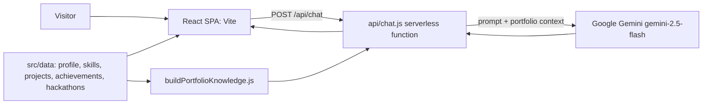

# Portfolio: S Shriram

My personal portfolio website: a single-page React app showing my skills, projects, achievements, education and contact options, with an AI chat assistant that answers questions about the portfolio.

**Links:** [Live site](https://portfolio-s-shriram.vercel.app) · [GitHub](https://github.com/shriram-s7/portfolio-s-shriram)

## Overview

The site is a Vite + React + TypeScript app styled with Tailwind and shadcn/ui. All content lives in plain data files under `src/data/`, so updating the portfolio means editing data rather than components. A small serverless function (`api/chat.js`) powers the "Helper AI" chat: it builds a knowledge base from the same data files and asks Google Gemini to answer visitor questions using only that context.

## Features

- **Sections:** Hero, Skills (grouped, with proficiency bars), Projects (cards with a detail modal), Achievements and hackathons, Education, Contact, and a footer.
- **AI helper chat** (`HelperAIChat.tsx`): visitors ask about projects, skills or experience; answers come from the portfolio data via Gemini.
- **Visual polish:** custom cursor, animated wireframe/particle backgrounds, a tech-companion mascot and responsive mobile layouts.
- **Resume** downloads from `public/`.
- **SEO:** page title, description, Open Graph tags and a canonical link set with `react-helmet-async`.

## How it works



The Gemini API key stays on the server side: the browser only calls `/api/chat`. In development, a small Vite middleware (`vite.config.ts`) serves `/api/chat` locally and loads the key from `.env.local`; on Vercel the same file runs as a serverless function.

## Tech stack

| Layer | Technology |
|---|---|
| Framework | React 18, TypeScript, Vite (SWC) |
| Styling and UI | Tailwind CSS, shadcn/ui (Radix UI), lucide-react |
| Routing and data | React Router, TanStack Query |
| AI chat | Google Gemini (`@google/generative-ai`, model `gemini-2.5-flash`) |
| Hosting | Vercel (static build and serverless function) |

## Project structure

```text
src/
  components/portfolio/   Hero, Skills, Projects, ProjectModal, Achievements, Education, Contact, Navbar, Footer
  components/             HelperAIChat, TechCompanion, CustomCursor and background effects
  components/ui/          shadcn/ui primitives
  data/                   profileData, skillsData, projectsData, achievementsData, hackathonsData
  lib/buildPortfolioKnowledge.js   turns the data files into the chat knowledge base
  pages/                  Index (the page) and NotFound
api/chat.js               Gemini-backed chat endpoint
public/                   resume, logos, certificates, assets
```

## Getting started

Prerequisites: Node.js 18 or newer and npm.

**Windows (PowerShell)**

```powershell
npm ci
Copy-Item .env.example .env.local   # then put your Gemini key in .env.local
npm run dev                          # http://localhost:8080
```

**Linux / macOS**

```bash
npm ci
cp .env.example .env.local           # then put your Gemini key in .env.local
npm run dev
```

Environment variable: `GEMINI_API_KEY` is your own Google Gemini API key, used only by `api/chat.js` (see `.env.example`). Without it the site works, but the chat returns a "Missing GEMINI_API_KEY" error. `.env.local` is git-ignored; never commit a real key.

Build and preview: `npm run build` then `npm run preview`.

## Usage

Open the site, scroll through the sections, open a project card for details, and click the chat mascot to ask the Helper AI a question such as "What projects use machine learning?". To update content, edit the files in `src/data/` and the resume PDF in `public/`.

## Tests

There is no automated test suite. Observed while writing this README: `npm ci` and `npm run build` succeeded. `npm run lint` and the chat endpoint (which needs a Gemini key) were not run.

## Status and limitations

- Live and maintained as a personal site; content is static data edited by hand.
- The chat depends on the Gemini API, can be wrong, and is only as accurate as the data files.
- `groq-sdk` is listed in `package.json` but is not used by the code.
- The `/api/chat` handler allows any origin (`Access-Control-Allow-Origin: *`) and has no rate limiting, so a deployed key can be used by anyone who calls the endpoint.
- No license file; the code and content are shared for viewing.

## License

No license specified.
